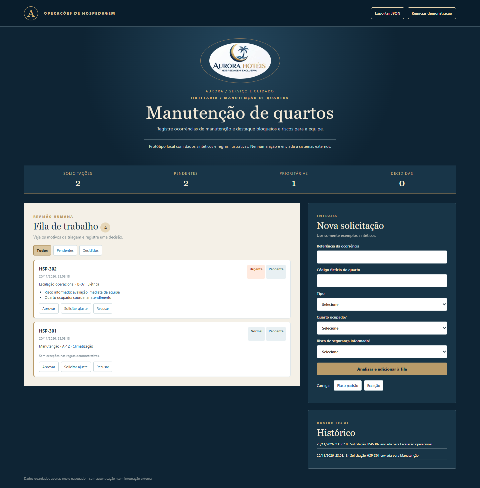

# AURORA HOTÉIS — Hospedagem Exclusiva

**Status: PROTOTYPE**

Protótipo funcional preparado para uma futura apresentação à AURORA HOTÉIS. O nome, a descrição **Hospedagem Exclusiva** e o logo foram fornecidos pelo usuário, que declarou possuir autorização para uso público. O fluxo proposto ainda não foi validado pela empresa; este registro não afirma entrega, implantação ou resultados.

## Solução demonstrável

Registro local de ocorrências de manutenção em quartos fictícios. O formulário capta referência, código de quarto, categoria, ocupação e risco informado. A triagem demonstrativa destaca risco de segurança para escalação operacional e ocupação para coordenação com a equipe. Decisões simuladas exigem justificativa e permanecem no navegador com histórico e exportação JSON.

## Executar

Na raiz do repositório, execute `python -m http.server 8768` e abra [este iniciador local](./index.html). Requer Python 3.10+ e navegador moderno. O [código compartilhado](../../../Demo%20Templates/AI%20Product%20Development/four-industry-prototypes/) implementa o fluxo; esta pasta guarda a entrada de apresentação e o print.

## Limites e próxima etapa

O print e os exemplos usam dados sintéticos. A classificação não é um procedimento de segurança aprovado pela AURORA HOTÉIS. Não há PMS, governança, ordens de serviço, sensores, autenticação ou modelo de IA conectado. A próxima etapa é apresentar o protótipo, validar critérios de prioridade e especificar integrações autorizadas.
