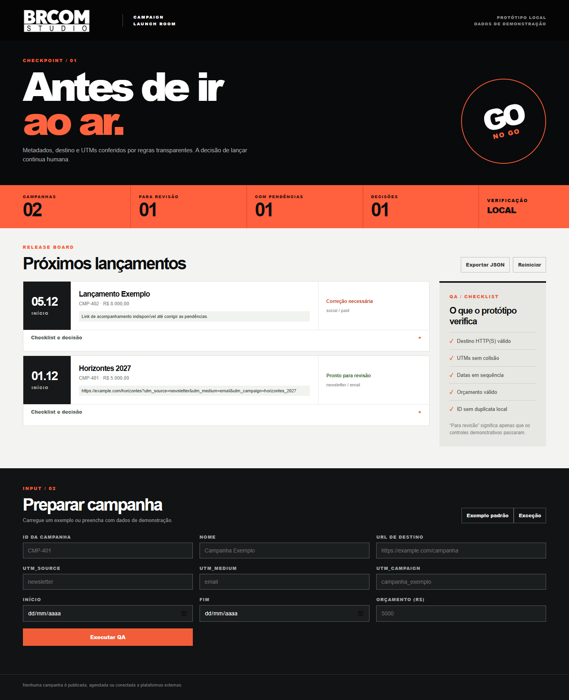

# BRCOM Studio — Marketing / agências

**Status: PROTOTYPE**

Protótipo funcional preparado para apresentação. O nome e o logo foram fornecidos pelo usuário. Os cenários e valores são demonstrativos; não há campanha implantada, resultado atribuído ou validação operacional alegada.

## Ferramenta

Campaign Launch QA: formulário de metadados, datas, orçamento e UTMs; verificação explícita de URL HTTP(S), colisões de parâmetros, duplicatas locais e sequência de datas; geração de URL rastreável quando os controles passam. O release board mostra campanhas prontas para revisão e pendências. Uma pessoa pode registrar decisão com justificativa. O histórico fica no navegador e pode ser exportado em JSON.

Base conceitual reutilizada: [Campaign Launch QA & UTM Builder](../../../Demo%20Templates/Marketing%20Intelligence%20%26%20Business%20Automation/campaign-launch-qa/).

## Executar

Na raiz do repositório, execute python -m http.server 8769 --bind 127.0.0.1 e abra http://127.0.0.1:8769/01.CLIENT%20CASES/AI%20INNOVATION/brcom-studio-marketing/. Requer Python 3.10+ e navegador moderno. Use **Exemplo padrão** e **Exceção** para demonstrar o checklist.

## Limites e próxima etapa

Campanhas, destinos example.com e valores são sintéticos. O estado “Pronto para revisão” não autoriza publicação. Não há conexão com Google Analytics, plataformas de mídia, agenda, automação de marketing ou modelo de IA. O protótipo não publica nem agenda campanhas. A integração futura depende da taxonomia, das políticas e das plataformas validadas com a empresa.
