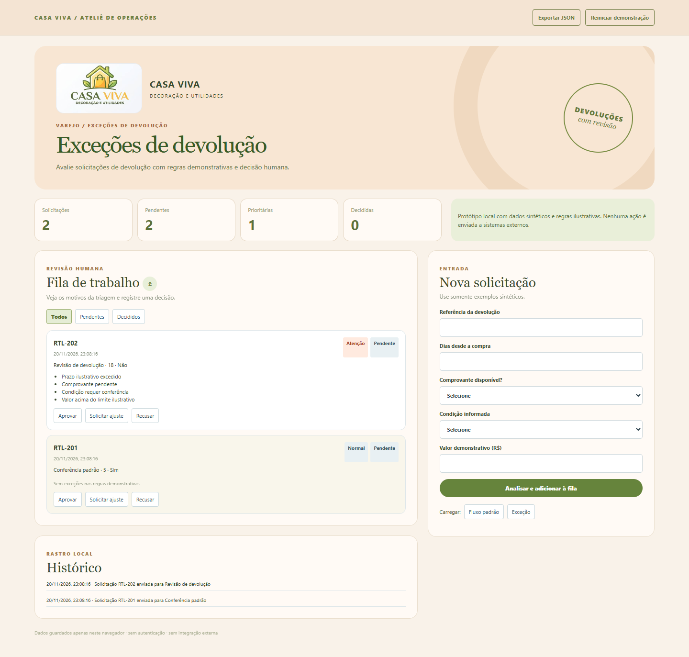

# CASA VIVA — Decoração e Utilidades

**Status: PROTOTYPE**

Protótipo funcional preparado para uma futura apresentação à CASA VIVA. O nome, a descrição **Decoração e Utilidades** e o logo foram fornecidos pelo usuário, que declarou possuir autorização para uso público. O fluxo proposto ainda não foi validado pela empresa; este registro não afirma entrega, implantação ou resultados.

## Solução demonstrável

Triagem local de solicitações de devolução. O formulário registra referência, dias desde a compra, comprovante, condição informada e valor demonstrativo. Regras ilustrativas destacam prazo, ausência de comprovante, condição do item e valor acima de um limite de exemplo. As exceções entram em revisão humana com decisão justificada, histórico e exportação JSON.

## Executar

Na raiz do repositório, execute `python -m http.server 8768` e abra [este iniciador local](./index.html). Requer Python 3.10+ e navegador moderno. O [código compartilhado](../../../Demo%20Templates/AI%20Product%20Development/four-industry-prototypes/) implementa o fluxo; esta pasta guarda a entrada de apresentação e o print.

## Limites e próxima etapa

O print e os exemplos usam dados sintéticos. Os prazos, limites e condições são ilustrativos, não uma política de trocas da CASA VIVA. Não há e-commerce, OMS, estoque, pagamento, atendimento, autenticação ou modelo de IA conectado. A próxima etapa é apresentar o protótipo, validar a política aplicável e especificar integrações autorizadas.
