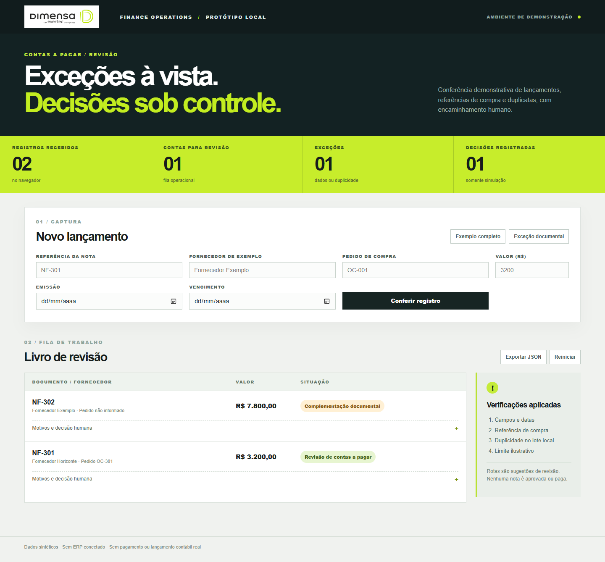

# Dimensa — Contabilidade / BPO financeiro

**Status: PROTOTYPE**

Protótipo funcional preparado para futura apresentação. O nome e o logo foram fornecidos pelo usuário. O processo e as regras são hipóteses demonstrativas; não há validação, implantação ou resultado atribuído à Dimensa.

## Ferramenta

Mesa local de conferência de contas a pagar. O formulário registra fornecedor de exemplo, referência da nota, pedido de compra, valor e datas. Regras explícitas verificam duplicatas no histórico local, campos ausentes, sequência de datas e limite ilustrativo de revisão. A fila separa conferência operacional, revisão gerencial e exceções. Decisões humanas exigem justificativa. O histórico permanece no navegador e pode ser exportado em JSON.

Base conceitual reutilizada: [Invoice Intake & Exception Routing](../../../Demo%20Templates/AI%20Automation%20%26%20Workflows/invoice-intake-exception-routing/).

## Executar

Na raiz do repositório, execute python -m http.server 8769 --bind 127.0.0.1 e abra http://127.0.0.1:8769/01.CLIENT%20CASES/AI%20INNOVATION/dimensa-bpo-financeiro/. Requer Python 3.10+ e navegador moderno. Use **Exemplo completo** e **Exceção documental** para demonstrar as rotas.

## Limites e próxima etapa

Fornecedores, referências, valores e datas dos exemplos são sintéticos. Nenhuma nota é aprovada ou paga; não há lançamento contábil, ERP, autenticação, OCR ou modelo de IA conectado. A integração futura depende de validação de campos, políticas e plataformas com a empresa.
