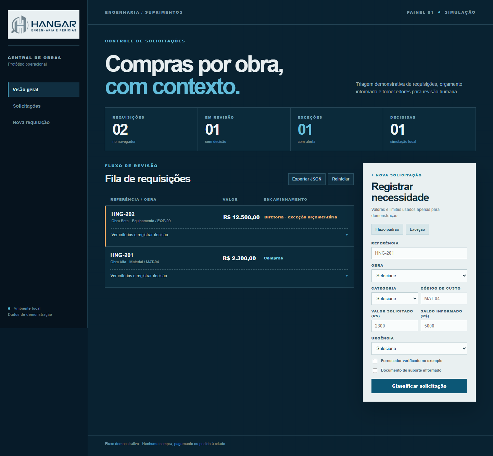

# HANGAR Engenharia e Perícias — Construção civil

**Status: PROTOTYPE**

Protótipo funcional preparado para futura apresentação. O nome e o logo foram fornecidos pelo usuário. O processo, os limites e as filas são hipóteses demonstrativas; não há validação, implantação ou resultado atribuído à HANGAR.

## Ferramenta

Mesa local de solicitações de compra por obra. O formulário registra referência, obra, categoria, código de custo, valor, saldo informado, urgência, situação do fornecedor e documento de suporte. Regras explícitas destacam duplicatas, saldo insuficiente, fornecedor não verificado e documentação ausente. A fila sugere revisão por gestor, compras, financeiro, diretoria ou diligência. Uma pessoa pode registrar a decisão simulada com justificativa. O histórico fica no navegador e pode ser exportado em JSON.

Base conceitual reutilizada: [SME Procurement Request Triage Agent](../../../Demo%20Templates/AI%20Agents%20%26%20Agentic%20Systems/sme-procurement-request-triage/).

## Executar

Na raiz do repositório, execute python -m http.server 8769 --bind 127.0.0.1 e abra http://127.0.0.1:8769/01.CLIENT%20CASES/AI%20INNOVATION/hangar-construcao-civil/. Requer Python 3.10+ e navegador moderno. Use **Fluxo padrão** e **Exceção** para demonstrar as rotas.

## Limites e próxima etapa

Obras, fornecedores, saldos, referências e valores são sintéticos. A classificação não aprova compras, não cria pedidos e não altera orçamento real. Não há ERP, Procore, financeiro, autenticação ou modelo de IA conectado. Antes de integrar, valide campos, limites, responsáveis e sistemas com a empresa.
