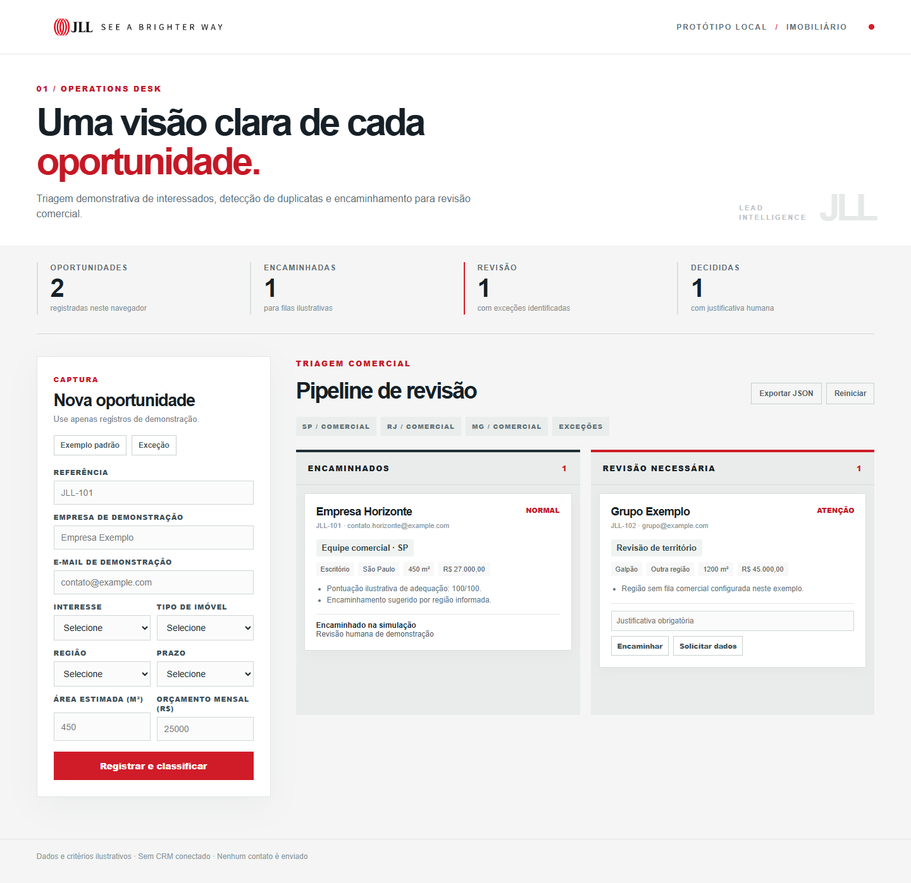

# JLL — Imobiliário

**Status: PROTOTYPE**

Protótipo funcional preparado para futura apresentação. O nome e o logo foram fornecidos pelo usuário para compor este case. O fluxo e as regras são hipóteses demonstrativas; não há validação, implantação ou resultado atribuído à JLL.

## Ferramenta

Central local de qualificação de interessados em imóveis comerciais. O formulário registra referência, empresa, e-mail de exemplo, interesse, tipo de imóvel, região, área, orçamento e prazo. Regras explícitas detectam duplicatas no histórico local, calculam uma pontuação ilustrativa e sugerem uma fila comercial por região. Exceções ficam em revisão; decisões humanas exigem justificativa. Há persistência no navegador e exportação JSON.

Base conceitual reutilizada: [CRM Lead Qualification & Routing](../../../Demo%20Templates/AI%20Automation%20%26%20Workflows/crm-lead-qualification-routing/).

## Executar

Na raiz do repositório, execute python -m http.server 8769 --bind 127.0.0.1 e abra o protótipo em http://127.0.0.1:8769/01.CLIENT%20CASES/AI%20INNOVATION/jll-imobiliario/. Requer Python 3.10+ e navegador moderno. Use os botões **Exemplo padrão** e **Exceção**, registre os exemplos, revise as filas e documente uma decisão.

## Limites e próxima etapa

Os registros, referências, e-mails example.com, pontuação e filas são sintéticos. Não há CRM, agenda, mapa, autenticação, mensagens ou modelo de IA conectado. Nenhum contato é enviado. A próxima etapa é validar com a empresa seus campos, critérios, responsáveis e sistemas antes de qualquer integração.
