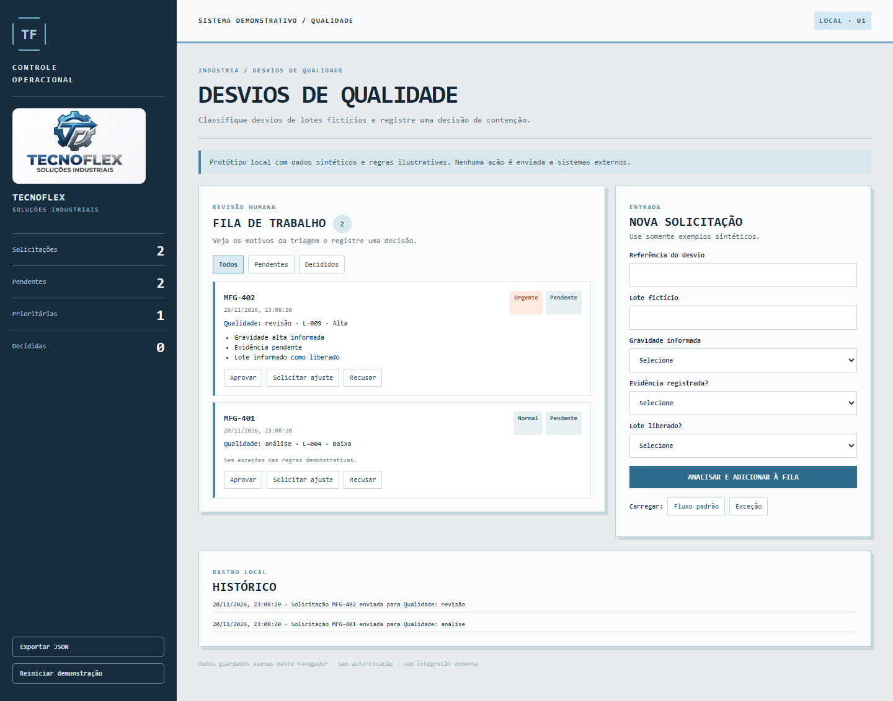

# TECNOFLEX — Soluções Industriais

**Status: PROTOTYPE**

Protótipo funcional preparado para uma futura apresentação à TECNOFLEX. O nome, a descrição **Soluções Industriais** e o logo foram fornecidos pelo usuário, que declarou possuir autorização para uso público. O fluxo proposto ainda não foi validado pela empresa; este registro não afirma entrega, implantação ou resultados.

## Solução demonstrável

Triagem local de desvios de qualidade em lotes fictícios. O formulário registra referência, lote, gravidade, evidência e situação de liberação informada. Regras demonstrativas destacam gravidade alta, evidência pendente e lote informado como liberado. A revisão humana permite justificar uma decisão simulada, manter histórico local e exportar JSON.

## Executar

Na raiz do repositório, execute `python -m http.server 8768` e abra [este iniciador local](./index.html). Requer Python 3.10+ e navegador moderno. O [código compartilhado](../../../Demo%20Templates/AI%20Product%20Development/four-industry-prototypes/) implementa o fluxo; esta pasta guarda a entrada de apresentação e o print.

## Limites e próxima etapa

O print e os exemplos usam dados sintéticos. A triagem não é um procedimento de qualidade ou contenção aprovado pela TECNOFLEX. Não há ERP, MES, QMS, controle físico de lote, autenticação ou modelo de IA conectado. A próxima etapa é apresentar o protótipo, validar o processo de qualidade e especificar integrações autorizadas.
