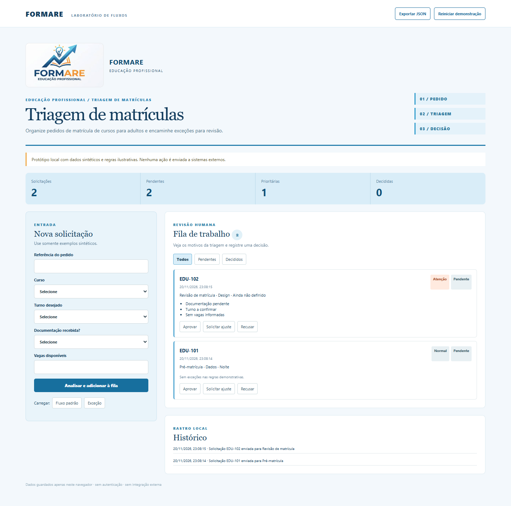

# FORMARE — Educação Profissional

**Status: PROTOTYPE**

Protótipo funcional preparado para uma futura apresentação à FORMARE. O nome, a descrição **Educação Profissional** e o logo foram fornecidos pelo usuário, que declarou possuir autorização para uso público. O fluxo proposto ainda não foi validado pela empresa; este registro não afirma entrega, implantação ou resultados.

## Solução demonstrável

Triagem local de solicitações de matrícula em cursos para adultos. O formulário registra referência, curso, turno, documentação e vagas informadas. Regras demonstrativas encaminham solicitações completas para pré-matrícula e exceções para revisão humana. A equipe pode registrar uma decisão simulada com justificativa, consultar o histórico local e exportar JSON.

## Executar

Na raiz do repositório, execute `python -m http.server 8768` e abra [este iniciador local](./index.html). Requer Python 3.10+ e navegador moderno. O [código compartilhado](../../Demo%20Templates/AI%20Product%20Development/four-industry-prototypes/) implementa o fluxo; esta pasta guarda a entrada de apresentação e o print.

## Limites e próxima etapa

O print e os exemplos usam dados sintéticos. As regras, cursos, turnos e disponibilidade são ilustrativos, não políticas da FORMARE. Não há CRM, sistema acadêmico, mensagens, autenticação ou modelo de IA conectado. A próxima etapa é apresentar o protótipo, validar campos e responsáveis com a empresa e especificar integrações autorizadas.
